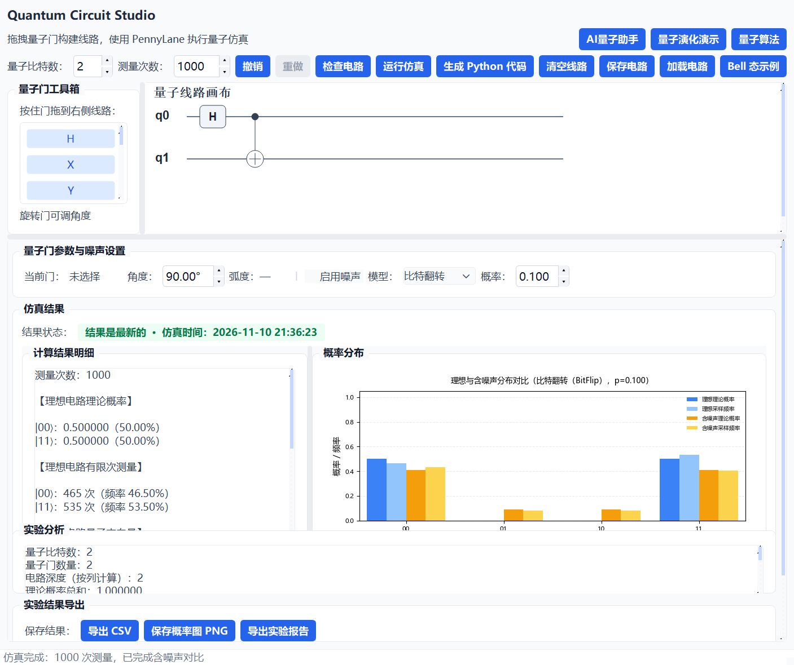
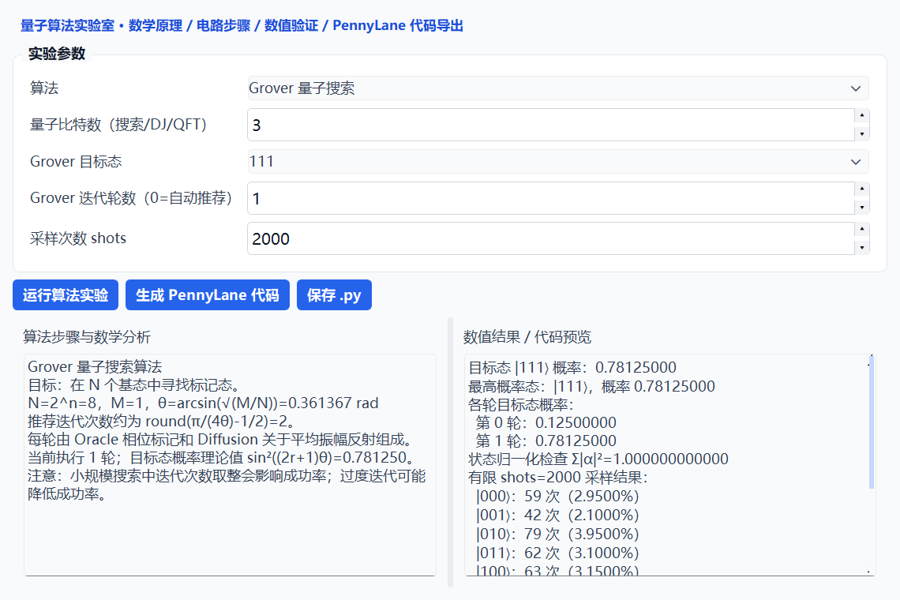

# Quantum Circuit Studio

**量子电路仿真平台** — 用拖拽搭建量子线路，用 PennyLane 精确仿真，把结果、图表和实验报告一次导出。

[](https://www.python.org/)
[](https://doc.qt.io/qtforpython/)
[](https://pennylane.ai/)
[](LICENSE)

一款面向教学与自学的桌面量子计算工具：左侧拖入量子门，右侧实时看到状态向量、概率分布与电路指标；不写一行代码就能观察叠加、纠缠与噪声对结果的影响，需要时再把线路导出成可运行的 PennyLane 脚本。



## 功能特性

**可视化搭建**
- 1–8 个量子比特，拖拽 `H / X / Y / Z / RX / RY / RZ / CNOT` 到线路画布
- `RX / RY / RZ` 旋转角可调，角度与弧度实时换算
- 门可拖动改位、`Delete` 删除，完整的撤销 / 重做历史

**精确仿真**
- 基于 PennyLane 状态向量模拟器，给出理论概率与量子态振幅（含相位）
- 可切换有限次测量（shots），按理论概率做多项分布采样，直观对比采样频率与理论值
- 内置噪声模型：BitFlip / PhaseFlip / Depolarizing；开启噪声时自动切换到 `default.mixed` 密度矩阵模拟器

**结果与导出**
- 概率分布柱状图（理论 vs 采样）、电路深度、门数量、纠缠熵、总变差距离等指标
- 导出 CSV 数据、图表 PNG、Markdown 实验报告、可直接运行的 PennyLane 代码
- 电路与实验配置保存 / 加载为 JSON，便于复现与分享

**量子算法实验室**
- Grover 搜索、Deutsch–Jozsa、量子隐形传态、量子傅里叶变换
- 每种算法给出数学推导、线路步骤、逐轮数值验证与代码导出

**量子态演化演示**
- 逐步展示单比特到多比特态的演化过程，配合布洛赫球与概率图讲解

**AI 助手（可选）**
- 用自然语言描述需求，生成可校验的电路 JSON 并载入画布
- 解释当前电路的行为，或生成实验报告
- 未配置 API Key 时其余功能完全可用



## 下载即用（Windows）

不想装 Python 的话，用打包好的版本：

1. 打开 [Releases](https://github.com/xia1314tong/quantum-circuit-studio/releases/latest)，下载 `QuantumCircuitStudio-1.0.0-win64.zip`（约 123 MB）
2. 解压到任意目录，双击 `量子电路仿真平台.exe`

免安装、免配置，首次启动约 3–5 秒。AI 助手需要自己的 DeepSeek API Key，把 `deepseek_config.json` 放到 exe 同级目录即可（格式见 `deepseek_config.example.json`）；不配置也不影响仿真、导出与算法实验室。

> 打包版为 Windows x64；macOS / Linux 请从源码运行。

## 从源码运行

### 环境要求

- Python 3.10+（开发与验证使用 3.10.11）
- Windows 10/11；依赖均为纯 Python 包，macOS / Linux 亦可运行

### 安装与运行

```bash
git clone https://github.com/xia1314tong/quantum-circuit-studio.git
cd quantum-circuit-studio
python -m pip install -r requirements.txt
python main.py
```

### 配置 AI 助手（可选）

```bash
cp deepseek_config.example.json deepseek_config.json
```

在 `deepseek_config.json` 中填入自己的 API Key：

```json
{
  "api_key": "sk-your-key",
  "model": "deepseek-flash"
}
```

也可以用环境变量 `DEEPSEEK_API_KEY` 提供 Key，此时以配置文件为准。

> `deepseek_config.json` 已被 `.gitignore` 忽略，**本仓库不包含任何密钥**。提交代码或分发程序前请确认它不在版本控制中。

## 使用提示

| 操作 | 方式 |
| --- | --- |
| 添加量子门 | 从左侧工具箱拖到线路画布 |
| 移动 / 删除 | 拖动已有门；选中后按 `Delete` |
| 撤销 / 重做 | `Ctrl+Z` / `Ctrl+Y`（或 `Ctrl+Shift+Z`） |
| 载入示例 | 点击「Bell 态示例」 |

典型流程：拖出 `H` + `CNOT` → 运行仿真 → 观察 `|00⟩` 与 `|11⟩` 各占 50% → 导出报告或 PennyLane 代码。

## 教学判据：这次演示还能不能信

对 `H(q0) + CNOT(q0, qi)` 构成的 GHZ 族，在门级比特翻转噪声下，含噪分布与理想分布的总变差距离（TVD）
有闭式解，可在 O(n) 时间内算出。给定「TVD 不超过 10%」的口径，就能反解出每个比特数对应的噪声上限 p*(n)：

| n | 2 | 3 | 4 | 5 | 6 | 7 | 8 |
| --- | --- | --- | --- | --- | --- | --- | --- |
| p*(n) | 0.053 | 0.026 | 0.018 | 0.013 | 0.011 | 0.009 | 0.008 |

实现见 `quantum_circuit_studio/thresholds.py`（约 100 行，不引入额外依赖），对应测试在 `tests/test_thresholds.py` 与 `tests/test_gui.py`。
开启噪声仿真后，分析面板会多出一行提示：当前比特数对应的 p*(n)、以及当前噪声是否已越过 10% 偏差边界。模型推导与实验数据不在本仓库。

## 实验代码

`experiments/` 是本项目做定量验证用的脚本：噪声容限判据、误差缓解对照、以及 LLM 生成电路的三臂对照实验。运行 `python -m experiments.reproduce` 会把 CSV 结果与图重新生成到 `experiments/results/` 和 `experiments/figures/`。

这部分不影响工具本身的使用，只是为了让文章里的数字可以从仓库复算出来。

## 项目结构

```text
quantum-circuit-studio/
├── main.py                          # 程序入口：QApplication、图标、全局样式
├── quantum_circuit_studio/
│   ├── common.py                    # 常量、资源路径、图标辅助函数
│   ├── engine.py                    # 纯计算层：仿真、指标、采样（不依赖 Qt）
│   ├── thresholds.py                # 教学容限判据 p*(n)（纯 Python，无额外依赖）
│   ├── widgets.py                   # 量子门工具箱、线路画布、AI 请求线程
│   ├── main_window.py               # 主窗口：Mixin 组合与配置加载
│   ├── algorithm_lab.py             # 量子算法实验室（Grover / DJ / 传态 / QFT）
│   ├── quantum_demo.py              # 量子态演化教学演示
│   └── mixins/
│       ├── ui.py                    # 界面布局、控件与事件
│       ├── circuit.py               # 电路校验、清空、示例载入
│       ├── simulation.py            # 仿真结果渲染（计算已下沉到 engine.py）
│       ├── assistant.py             # AI 助手对话与代码生成
│       ├── exports.py               # CSV / 图片 / 报告 / 配置导入导出
│       └── history.py               # 撤销重做栈与快捷键
├── experiments/                     # 判据 / 缓解 / LLM 生成可靠性的实验脚本与结果
├── tests/                           # pytest：计算层 / 判据 / 算法 / 界面
├── docs/                            # 界面截图
├── requirements.txt
├── requirements-dev.txt
└── deepseek_config.example.json
```

主窗口采用 **组合 + Mixin** 的分层方式：`MainWindow` 只负责组合与初始化，具体能力（界面、电路、仿真、导出、助手、历史）各自独立成模块，便于单独阅读和替换。计算逻辑集中在 `engine.py`，测试可直接对解析解断言，无需启动界面。

## 常见问题

**matplotlib 图表中文显示为方块？**
`common.py` 中已按平台设置中文字体候选；若系统缺少该字体，请安装或改为本机已有字体。

**运行后没有任何反应？**
确认使用的是安装了依赖的解释器（`python -m pip list | findstr PySide6`），而不是系统中其他 Python。

**开启噪声后结果与理想情况差异很大？**
噪声按比特逐个施加，概率越高偏差越明显；这是密度矩阵模拟的真实行为，可用于对比「理想 vs 含噪」两种结果。

**AI 助手报错 / 无响应？**
检查 Key 是否有效、模型名是否正确、账户是否有余额；网络受限时可先只用仿真与算法实验室功能。

## 技术说明

- 仿真：PennyLane `default.qubit`（理想）与 `default.mixed`（含噪声）
- 数值：状态向量 / 密度矩阵直接计算，指标由 Python 与 NumPy 实现
- 界面：PySide6（Qt for Python），自定义 QSS 主题
- 算法实验室的有限采样由理论概率做多项分布抽样得到，属于教学级演示，不追求硬件级噪声建模

## 许可证

本项目基于 [MIT License](LICENSE) 开源。
